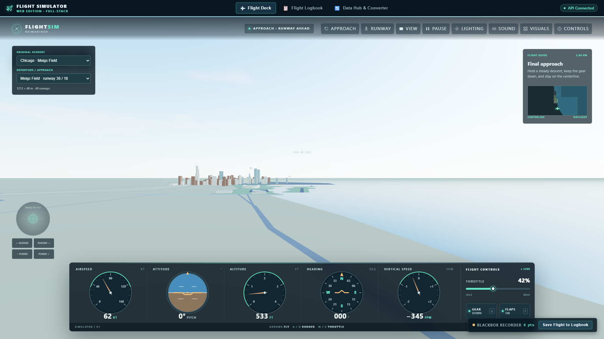
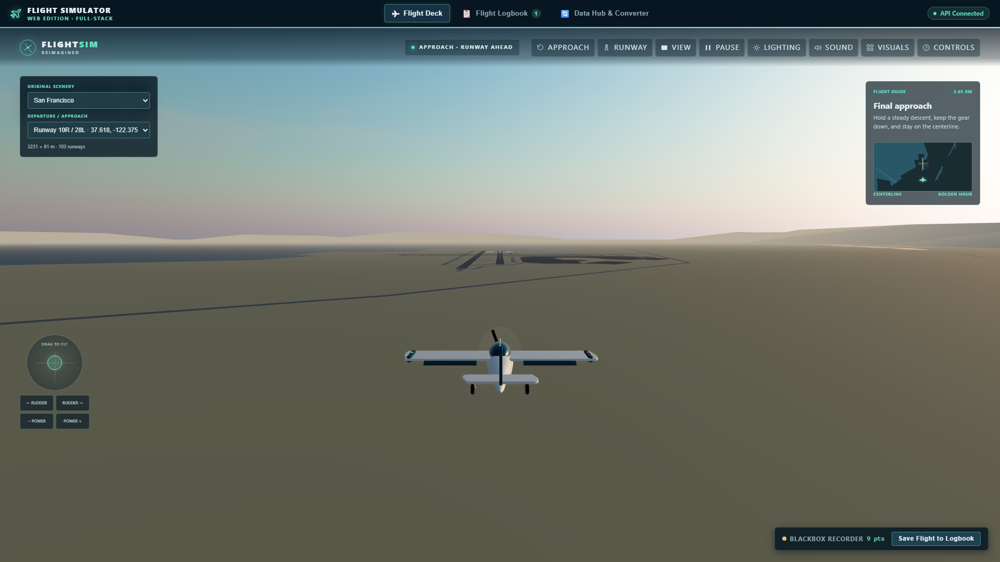
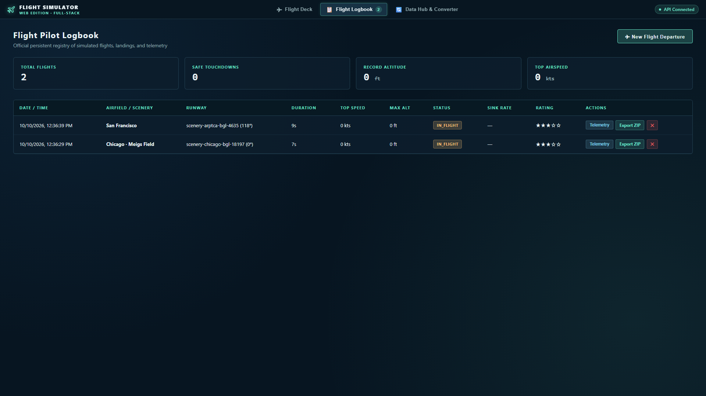
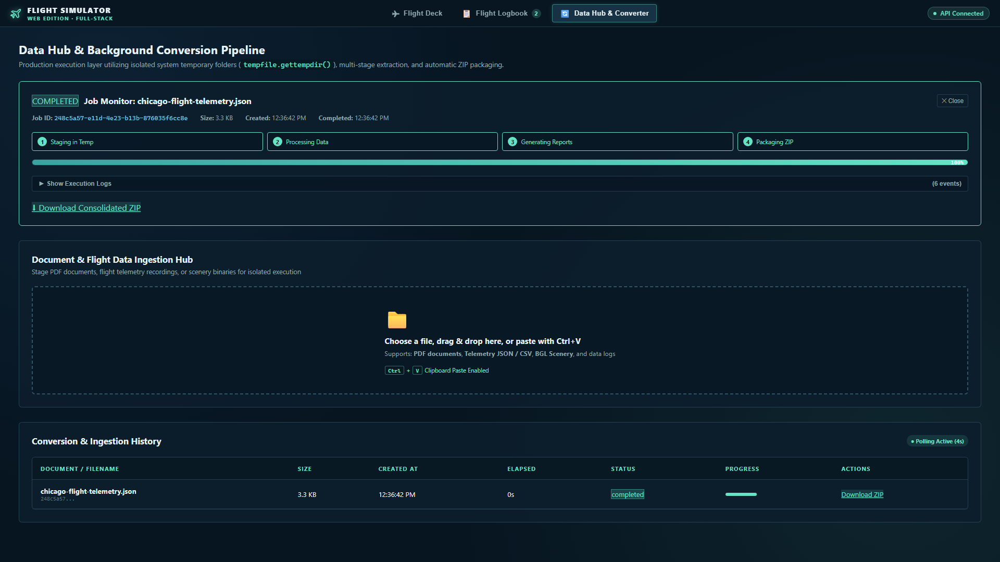

# Flight Simulator · Full-Stack Web Edition

A productionized full-stack web application featuring an interactive 3D flight simulator powered by Three.js and a high-performance FastAPI backend in Python with isolated system temporary folder processing, durable SQLite persistence, pilot logbook with telemetry recording, and a data conversion hub.

---

## Screenshots

### Flight Deck

The 3D cockpit combines runway scenery, classic flight instruments, and a live telemetry recorder.



### Chase View

Switch to the external chase camera for a view of the aircraft and surrounding scenery.



### Pilot Flight Logbook

Review recorded flights, performance statistics, ratings, telemetry, and ZIP exports.



### Data Hub

Upload documents, telemetry, or scenery files and track background conversion jobs.



---

## Architecture & Project Topology

The application follows the productionization standards defined in `skill/productionization/SKILL.md`:

```text
flight-simulator/
├── original-project/          # Original Flight Simulator scripts & scenery maps (preserved)
├── backend/                   # Python FastAPI backend service
│   ├── app/
│   │   ├── main.py            # FastAPI application entrypoint & API routes
│   │   ├── config.py          # Environment settings & path configurations
│   │   ├── database.py        # SQLite persistence for jobs & flight logbook
│   │   ├── schemas/           # Pydantic schemas (flight, job, scenery)
│   │   ├── services/          # Business logic: pipeline runner, flight service, scenery service
│   │   └── utils/             # TempManager: isolated OS temp folder lifecycle
│   ├── requirements.txt       # Python backend dependencies
│   └── tests/                 # Unit & integration tests
├── frontend/                  # ReactJS Web UI (Vite + TypeScript)
│   ├── src/
│   │   ├── App.tsx            # Main application layout & screen navigation
│   │   ├── components/        # Navigation, FlightSimulator, FlightLogbook, DataHub
│   │   ├── simulator/         # Three.js 3D world, aerodynamics model, audio, SVG instruments
│   │   └── services/          # Frontend API client
│   ├── public/maps/           # Converted scenery maps (Chicago, SF, LA, NYC, Paris, etc.)
│   └── package.json
├── e2e/                       # Playwright end-to-end integration tests
├── screenshot/                # Application screenshots shown in this README
├── setup.py / setup.bat       # Cross-platform automated setup orchestrator
├── run.py / run.bat           # Unified concurrent runner with graceful shutdown
└── secrets.md                 # Security & credential scan audit trail
```

---

## Key Features

### 1. Flight Deck (3D Interactive Cockpit)
- **Flight Physics Engine**: Fixed 60Hz aerodynamics simulation with elevator, aileron, rudder, throttle, flaps, gear, stall, ground rollout, and touchdown physics.
- **Classic Cockpit Instruments**: Crisp SVG dials for Airspeed (with operating arcs), Artificial Horizon (pitch ladder & bank pointer), Altimeter (Kollsman window), Vertical Speed Indicator, and Heading Compass card.
- **Scenery & Runways**: Converted original scenery polygons, buildings, roads, shorelines, and runways across 9 major metropolitan areas (Chicago Meigs Field, San Francisco, Los Angeles, New York, Paris, Munich, Seattle, Champaign, Reno/Stead).
- **Audio Synthesizer**: Web Audio engine roar, stall warning horn, gear/flaps mechanical transitions, touchdown squeal, and impact sounds.
- **Flight Recorder**: Real-time blackbox telemetry recorder capturing 3D flight path, altitude, airspeed, and dynamics with one-click **Save Flight to Logbook**.

### 2. Pilot Flight Logbook
- Persistent SQLite logbook tracking flight sessions, departures, runway alignments, and landing accuracy.
- Pilot scorecards showing vertical touchdown speed (fpm), centerline deviation, rollout distance, and 5-star ratings.
- **Telemetry Explorer**: Interactive telemetry inspection displaying flight dynamics stream.
- **ZIP Export**: Generates and downloads a consolidated flight package containing:
  - `flight_summary.md`: Formatted pilot report
  - `telemetry.json`: High-resolution dynamics stream
  - `flight_track.csv`: Tabular spreadsheet track
  - `flight_path.kml`: 3D trajectory viewable in Google Earth

### 3. Data Hub & Background Conversion Pipeline
- **Multiple Ingestion Modes**: Native file picker, drag-and-drop dropzone, and **Clipboard Paste (`Ctrl+V`)** for PDF documents, scenery containers (`.bgl`), and flight telemetry logs.
- **Isolated System Temp Protocol**: All jobs execute within isolated directories under the operating system temporary directory (`tempfile.gettempdir() / "prod_jobs" / <uuid>`), guaranteeing zero workspace pollution.
- **Active Job Monitor**: 4-stage visual progress timeline, animated percentage progress bar, and collapsible real-time execution log viewer.
- **Lifecycle Controls**: **Continue** active jobs, **Discard & Purge** temporary directories, or **Download ZIP** archives upon completion.

---

## Quick Start

### Windows (PowerShell / Command Prompt)

```powershell
.\setup.bat
.\run.bat
```

### Linux / macOS

```bash
chmod +x setup.sh run.sh
./setup.sh
./run.sh
```

The runner automatically selects available ports (defaulting to backend `8000` and frontend `5173`) and launches both services concurrently.

- **Frontend Application**: <http://localhost:5173>
- **Backend API & Docs**: <http://localhost:8000/docs>

---

## Controls

| Key | Function |
| :--- | :--- |
| **Arrow Up / Down** | Pitch elevator down / up |
| **Arrow Left / Right** | Bank ailerons left / right |
| **A / D** | Rudder yaw left / right |
| **W / S** | Increase / decrease throttle |
| **G / F** | Toggle landing gear / flaps |
| **C / V** | Toggle Cockpit / Chase external camera view |
| **P / Space** | Pause / resume simulation |
| **R / T** | Restart approach / Runway takeoff start |
| **L / M** | Toggle Daylight / Sunset; Engine sound on / off |
| **H / B** | Open Flight controls / Visual fidelity guide |
| **Escape** | Dismiss active modal or pause |

*Mouse, touch, and pen pointer dragging on the circular yoke joystick and throttle slider are fully supported.*

---

## Verification & Testing

### Backend Unit & Integration Tests

```powershell
.venv\Scripts\python.exe -m unittest discover -s backend\tests -v
```

### Frontend Typecheck & Production Build

```powershell
cd frontend
npm run typecheck
npm run build
```

### Original Scenery Engine Tests

```powershell
cd original-project
npm test
```
